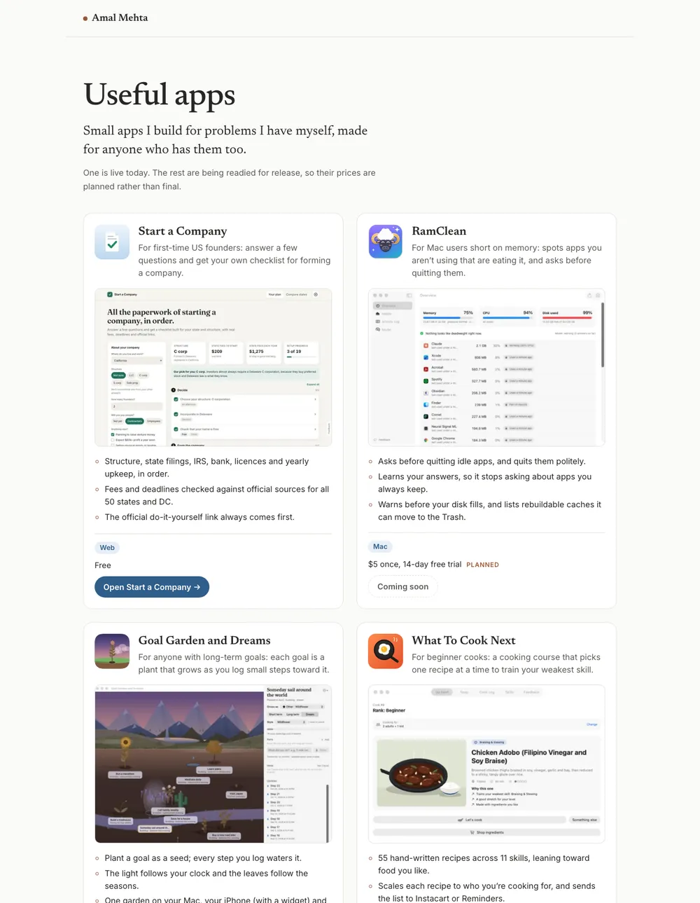

# Useful Apps

A small public page showing Amal Mehta's suite of useful apps, each with its icon, what it does, its platforms, its price and one next step.

**[Open the site →](https://amalmehta.github.io/UsefulApps/)**



- [Instructions](docs/INSTRUCTIONS.md): edit an app, add one, check and deploy
- [System design](docs/SYSTEM-DESIGN.md): why it's a plain static site, and what would change if it grew
- [File structure](docs/FILE-STRUCTURE.md): what's where
- [Project spec](UsefulApps.md)

## Preview locally

It's a plain static site with no build step. From the repo root:

```bash
python3 -m http.server 8000
```

Then open http://localhost:8000/.

## Licences

The bundled fonts, Inter and Newsreader, are licensed under the SIL Open Font License 1.1. See [fonts/OFL-Inter.txt](fonts/OFL-Inter.txt) and [fonts/OFL-Newsreader.txt](fonts/OFL-Newsreader.txt).
