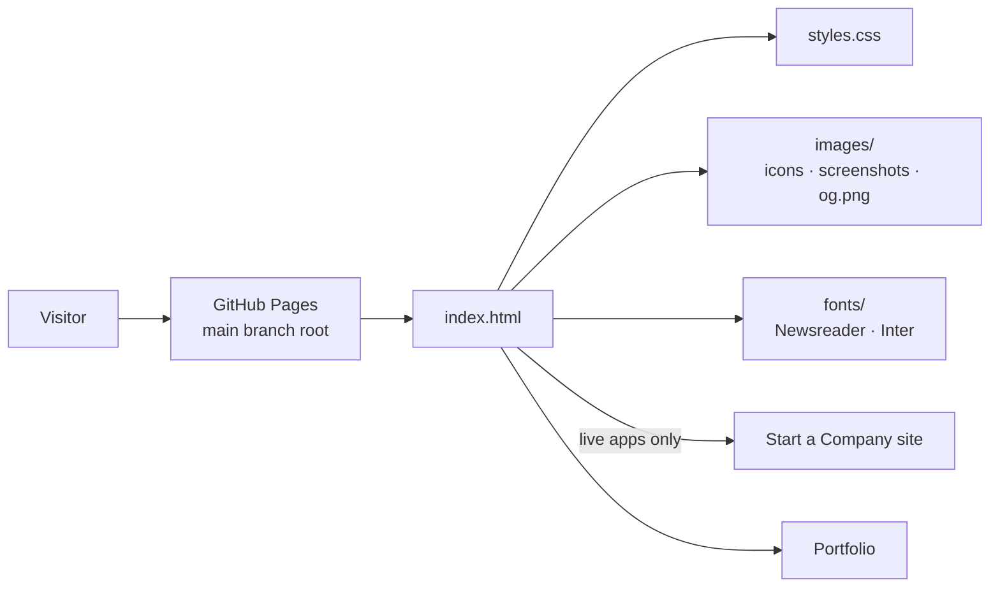

# System design

## What it is

One static page: `index.html`, `styles.css`, self-hosted fonts and WebP images. No JavaScript, no build step, no backend, no cookies or analytics. A content security policy allows only the site's own files.

## Why

- **Simplest thing that works:** six cards change rarely, by hand. A framework, generator or CMS would add more to maintain than it saves.
- **Matches the portfolio:** the portfolio is a plain static site too, so the palette, type and conventions carry straight over.
- **Fast and cheap:** about 400 KB in all, free hosting, nothing to keep running.

## Decisions and trade-offs

- **Content lives in the HTML.** Editing means copying a block. With six apps that's clearer than a data file plus a template.
- **Honest states.** Only public, live URLs are linked. Everything else says "Coming soon", and prices not yet on sale carry a "planned" tag.
- **Images:** 3:2 WebP screenshots at 480 and 960 px with `srcset`, 128 px WebP icons, lazy loading, and width and height set to avoid layout shift.
- **Accessibility:** alt text on every image, visible focus rings, a skip link, dark mode from `prefers-color-scheme`, contrast at WCAG AA or better.

## How it's tested

`tests/check_site.py` (standard library) checks that every referenced file exists, every image has alt text, no link is a placeholder, and every external link is https. Layout was checked by headless Chrome screenshots at 320, 375 and 1280 px, light and dark.

## Known limits

- Prices are copied from each app's config by hand, so they can drift. Re-check them when an app goes live.
- Messaging Graph has no screenshot yet.
- No analytics, so there's no way to see which apps people click.

## If it grew

- **Around 15–20 apps:** move each app into a `apps.json` and generate the cards with a small script or a static site generator, so the copy lives in one place per app. Add filters by platform.
- **When apps go on sale:** buy links and real store badges per card. Consider pulling prices from each app's own config at build time so they can't drift.
- **If visits matter:** a privacy-friendly analytics script (with the content security policy widened for it).
- **A custom domain:** a `CNAME` file and DNS, no code change.
